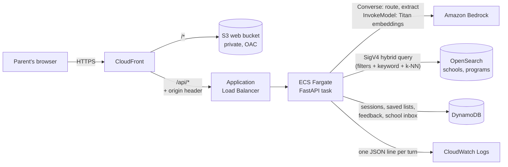

# Guided school search

A guided school-search agent for parents, built on AWS. The parent writes in plain language. Bedrock reads the request; code decides what is true. Every fact on a card cites the field or review it came from.

The demo city is Jacksonville. The clock the age rules use is 2026-11-03 (`GS_TODAY`).

## Architecture



```text
Parent ──HTTPS──► CloudFront ─┬─ /*      ─► S3 (React build, private bucket, origin access control)
                              └─ /api/*  ─► ALB ─► Fargate task: FastAPI
                                                      ├─► Bedrock      route + extract (Nova Lite), embeddings (Titan V2)
                                                      ├─► OpenSearch   hard filters + keyword + vector candidates
                                                      ├─► DynamoDB     sessions, saved lists, feedback, school inbox
                                                      └─► CloudWatch   criteria + OpenSearch query for every request
```

A turn: Bedrock routes the message and extracts criteria → code maps them to needs in `needs.yaml` → OpenSearch returns the schools that pass the hard filters (city, level, type) with keyword and vector relevance → code computes evidence, status and match score for each school → the browser renders the blocks. Session state is read from and written to DynamoDB, and the whole turn is logged as one JSON line.

## AWS services used

| Service | What it does here | Where |
|---|---|---|
| Amazon Bedrock | Amazon Nova Lite (Converse) routes each message and drafts criteria, which code maps to needs before use; Titan Text Embeddings V2 embeds documents and queries. A failed call falls back to the rules engine and the log says so. | `backend/agent/bedrock_client.py`, `backend/mapping/embedder.py` |
| Amazon OpenSearch Service | `schools` and `programs` indexes with a k-NN `embedding` field. Every search sends one SigV4-signed query: hard filters, a keyword match and a k-NN clause. | `backend/search/opensearch_client.py`, `data/index/` |
| Amazon DynamoDB | One on-demand table: sessions, saved lists, feedback, questions to schools, and schools' answers. | `backend/store.py` |
| Amazon ECS on Fargate | Runs the API container (0.5 vCPU, 1 GB) in public subnets, no NAT gateway. | `backend/Dockerfile`, `infra/` |
| Elastic Load Balancing | Internet-facing ALB in front of the task. It forwards only requests that carry CloudFront's secret header and answers 403 to anything else. | `infra/` |
| Amazon S3 + CloudFront | The React build in a private bucket, served over HTTPS through origin access control. `/api/*` goes to the ALB with caching off. | `infra/` |
| Amazon CloudWatch Logs | Log group `/gs-guided/api`, 7-day retention, with two saved Logs Insights queries. | `backend/observability.py`, `infra/` |
| AWS IAM | The Fargate task role: Bedrock invoke, OpenSearch `es:ESHttp*`, DynamoDB read/write on the one table. | `infra/lib/infra-stack.ts` |
| Amazon ECR | Holds the API image (pushed by `cdk deploy`). | `infra/` |
| AWS CDK / CloudFormation | Everything above is one stack, `InfraStack`. | `infra/` |

SES, Bedrock Guardrails and Amazon Location are stretch items (see [Stretch: SES, Guardrails, Location](#stretch-ses-guardrails-location)).

## How to run

### Locally (no AWS needed)

```bash
python3 -m venv .venv
.venv/bin/pip install -r backend/requirements.txt
cd frontend && npm install && cd ..
```

```bash
# API
cd backend && ../.venv/bin/python -m uvicorn app:app --host 127.0.0.1 --port 8000
```

```bash
# UI, in another terminal
cd frontend && npm run dev -- --host 127.0.0.1 --port 5173
```

Open http://127.0.0.1:5173. With no AWS settings the rules engine, the local search engine and a JSON state file stand in for Bedrock, OpenSearch and DynamoDB. The same code runs in AWS; only environment variables change.

To use the shared sandbox from a laptop, set these before starting the API (values come from the stack outputs):

```bash
export AWS_REGION=us-east-1 BEDROCK_ENABLED=1
export OPENSEARCH_URL=https://<DomainEndpoint>
export STATE_TABLE=<StateTableName>
```

Build the OpenSearch indexes once, using the same `BEDROCK_ENABLED` value the API uses (the deployed API also does this by itself at startup if they are missing):

```bash
.venv/bin/python data/index/indexer.py
```

### Deploy to AWS

Needs Node 20+, Docker running (CDK builds the API image), and AWS credentials for the sandbox in your shell.

```bash
cd infra
npm install
npx cdk bootstrap
npx cdk deploy
```

`cdk deploy` builds the frontend, builds and pushes the API image, and creates everything in the stack. It prints `SiteUrl`, the demo URL; it works on a phone. The first deploy takes about 20 minutes, mostly the OpenSearch domain and CloudFront. After it finishes, the API builds the OpenSearch indexes in the background (a minute or two); `GET <SiteUrl>/api/health` shows `"index": {"state": "ready", ...}` when it is done.

Deploy options (`-c key=value`):

| Option | Effect |
|---|---|
| `fastModelId=<id>` | Bedrock model for routing and extraction. Use an id from `bash infra/scripts/check-sandbox.sh` if the default in `backend/config/models.yaml` isn't enabled in your account. |
| `strongModelId=<id>` | Bedrock model for explanations. |
| `bedrock=0` | Run the API on the rules engine only. |
| `hosting=false` | Only OpenSearch and DynamoDB, for building from laptops. |

Before deploying into a new account, run the read-only check:

```bash
bash infra/scripts/check-sandbox.sh
```

### Check that it works

```bash
curl -s <SiteUrl>/api/health
```

```bash
curl -s <SiteUrl>/api/turn -H 'content-type: application/json' \
  -d '{"message":"Middle school in Jacksonville with STEM and after-school care. Money is tight."}'
```

The health response shows `"state_backend": "dynamodb"`, `"bedrock": true` and `"opensearch": true`. The turn's log line (below) shows `"opensearch": "on"` with the hit count, and one `bedrock` entry per call with `"ok": true`.

### Tests and eval

```bash
.venv/bin/python -m pytest backend/tests -q
```

```bash
.venv/bin/python eval/run_eval.py
```

```bash
cd infra && npx jest
```

The backend tests run DynamoDB against `moto`, so saved lists surviving a restart is tested without AWS.

### Demo script

Query:

> Middle school in Jacksonville with STEM and after-school care. Money is tight.

Then: answer the care question, ask a school from the inbox, ask why Mariner Elementary is missing, compare a private school (the cost panel links the official Florida pages and does not subtract an award), save a school with an unknown fact, ask "How liberal are these schools?", and mark a result "Too far".

Regenerate the synthetic corpus with `python data/synthetic/generate.py`. The 25 sample schools in `Sample Data/` stay unchanged. The generator writes 275 more schools, nearby programs, and one static page per generated school.

## Tracing a wrong result

Every `POST /api/turn` writes one JSON line to stdout, which on Fargate lands in CloudWatch Logs group `/gs-guided/api`. The response carries the same id as `trace_id` and in the `X-Trace-Id` header.

A line holds:

| Field | What it tells you |
|---|---|
| `message`, `action`, `answer`, `feedback` | What the parent sent |
| `criteria` | What the turn extracted: need, strength (require / prefer / avoid), location, grade, type |
| `bedrock[]` | Each Bedrock call: purpose (`route`, `extract`, `embed`), model, ok or the error, time, tokens, and the raw output |
| `searches[]` | Each search the turn ran: the OpenSearch query (vectors shortened to `<vector dim=256>`), `opensearch` = `on` / `off` / `error`, hits, the top ten school ids, and `not_in_index` if the index is behind the data |
| `results` | The school ids on screen, with match and verified counts |
| `route`, `duration_ms`, `error` | How the turn ended |

In CloudWatch → Logs Insights, open the saved query **gs-guided/turns** (or **gs-guided/fallbacks-and-errors**) and add a filter:

```text
filter trace_id = "64514a29116a4ff9"
```

Then read down the line: wrong `criteria` points at extraction, a school missing from `searches[].top` points at the query or the index, and a school present there but ranked wrong points at the evidence rules.

## Decisions

### Hosting (Track 4, task 1, decided Tue Nov 3)

**Local during the build, ECS Fargate for the demo.** Teammates run the API on their laptops against the shared Bedrock, OpenSearch and DynamoDB, so nobody waits on deploys. The demo runs one Fargate task behind an ALB and CloudFront.

Why Fargate rather than the alternatives:

- **Not Lambda.** A turn holds the corpus and need embeddings in memory and can make several Bedrock and OpenSearch calls; a long-running container avoids cold starts and the API Gateway timeout. It also matches how GreatSchools would run an agent service next to their Rails app.
- **Not App Runner.** Fewer pieces, but less control over networking and less like GreatSchools' setup. It stays the fallback if Fargate eats time.
- **Not a laptop for the demo.** Judges score AWS integration, and the demo URL has to load on a phone.

The frontend is a static build in a private S3 bucket behind CloudFront (task 4, the first option). CloudFront sends `/api/*` to the ALB, so the browser calls `/api` on one origin locally and in AWS: no CORS setup, no code changes between the two. The API container can also serve the build itself if `frontend/dist` exists, as a fallback.

### Infrastructure

- **One stack.** `npx cdk deploy` works with no stack name, so a second teammate can stand up a full backup in their own sandbox (task 6). The existing OpenSearch domain keeps its construct id, so deploying over the shared sandbox updates it in place instead of replacing it.
- **Public subnets, no NAT gateway.** The task gets a public IP to reach AWS APIs. The ALB is the only way in, and it only forwards requests carrying a header that CloudFront adds (the value is the stack's GUID); anything else gets 403.
- **The domain's policy trusts the account, and the task role also has its own permissions.** The role is allowed `bedrock:InvokeModel` on Claude, Nova and Titan, `es:ESHttp*` on the domain, and read/write on the state table, nothing more.
- **Amazon Nova Lite for routing and extraction, not Claude.** The first call to a Claude model has to subscribe the account through AWS Marketplace, and the hackathon account denies that (the CloudWatch log showed `AccessDeniedException` on every Converse call). Nova is Amazon's own model and needs no subscription. In an account that allows it, deploy with `-c fastModelId=us.anthropic.claude-haiku-5-5` to switch back; the role already has the Marketplace permissions.
- **Bedrock drafts, code decides.** The model's criteria are never used as-is: the rules extractor builds the criteria, and each phrase the model adds is mapped through the same rules (city, grade, type, or a need in `needs.yaml`). The first deployed run, before this rule, returned no schools because the model's "Jacksonville" was not a city filter; the request log is how it was found.
- **The API builds the OpenSearch indexes at startup if they are missing,** so a fresh deploy needs no laptop step. That is why the task role can write to the domain. Rebuild by hand with `python data/index/indexer.py --recreate`.
- **One DynamoDB table instead of six.** Keys are `pk` / `sk` (`SESSION#<id>` with `META`, `SAVED#<school>`, `FEEDBACK#<n>`; `INBOX`; `OVERLAY`). One grant, one thing to tear down; community posts and votes can be added under new key prefixes. Layout in `backend/store.py`.
- **Everything is `DESTROY` on delete,** including the table, because this is a hackathon sandbox.

### Search and evidence

- Hard filters are location, grade, and school type. Every other criterion is scored, so a missing field never drops a school.
- OpenSearch supplies candidates and text relevance; need boosts and evidence are computed in code. If a school passes the filters locally but is missing from the index, it stays in the results and the log lists it under `not_in_index`.
- Match score and evidence coverage are separate. Unknown scores 0.5. A high-confidence miss on a required criterion moves the school into "Missed a must-have" and keeps it on screen.
- Reviews can support a criterion. They never confirm one. A school website can fill a gap only up to Partial, and a conflict stays visible.
- The agent asks at most one question per turn, and only when the answer would change the top results, a required fact is unknown for many of them, or the phrase does not map to a need. Results show in the same turn, with the assumption stated.
- Scholarship lines say "You may qualify" and link the Florida Department of Education page. The screen does not promise an award amount. Net price stays empty.
- School email addresses are on `example.org`. SES sends only when `SES_ENABLED=1`, and only to `SES_VERIFIED_TO`.

## What code owns

| Piece | Where |
|---|---|
| Needs, phrases, evidence conditions | `backend/config/needs.yaml` |
| Scholarship rules and official links | `backend/config/funding_rules.yaml` |
| Term definitions | `backend/config/glossary.yaml` |
| Model ids (env `FAST_MODEL_ID` / `STRONG_MODEL_ID` override) | `backend/config/models.yaml` |
| Status, scoring, why-not | `backend/evidence/` |
| When to ask | `backend/clarify/` |
| Route, extract, cite, explain | `backend/agent/` |
| Search (OpenSearch client, local hybrid fallback, DSL) | `backend/search/` |
| State (DynamoDB or JSON file) | `backend/store.py` |
| Per-request log | `backend/observability.py` |
| Website, inbox, SES | `backend/gaps/` |
| Blocks the browser renders | `frontend/src/App.tsx` |
| AWS stack | `infra/lib/infra-stack.ts` |

GreatSchools can add or change a need by editing `needs.yaml`. A need has phrases (including Spanish), the field conditions for confirmed and partial, search boosts, and the question to ask on a visit. The mapper matches a parent's phrase to those entries. Unmapped phrases such as "how liberal" offer the needs marked `offer_when_unmapped`: inclusion, cultural responsiveness, restorative discipline, and non-religious.

## Configuration

| Variable | Default | What it does |
|---|---|---|
| `AWS_REGION` | `us-east-1` | Region for every AWS call |
| `BEDROCK_ENABLED` | off | `1` uses Bedrock Converse for routing and extraction and Titan for embeddings. A failed parse falls back to the rules engine. |
| `FAST_MODEL_ID`, `STRONG_MODEL_ID`, `EMBED_MODEL_ID` | from `models.yaml` | Override model ids without a code change |
| `OPENSEARCH_URL` | off | Domain endpoint. Searches go to OpenSearch (SigV4-signed) and fall back to the local engine on error. |
| `INDEX_ON_START` | off | `1` builds missing indexes in the background at startup (on in AWS) |
| `STATE_TABLE` | off | DynamoDB table for state. Off means `data/runtime/state.json` (`GS_STATE_PATH` overrides). |
| `TURN_LOG` | on | `0` turns off the per-request log line |
| `SES_ENABLED`, `SES_SOURCE`, `SES_VERIFIED_TO` | off | The inbox also sends through SES in sandbox mode |
| `GS_TODAY` | `2026-11-03` | The clock the age rules use |

## Stretch: SES, Guardrails, Location

Only once the community and "ask the school" work is built (Track 4, task 8). First run `bash infra/scripts/check-sandbox.sh`: it lists whether SES (and which addresses are verified), Bedrock Guardrails and Amazon Location are allowed in the sandbox, without creating anything. The SES path already exists behind `SES_ENABLED`; adding it to the deployed task means `ses:SendEmail` on the verified identity in the task role and the three `SES_*` variables in the container environment.

## Evaluation

`eval/queries.jsonl` has 42 parent queries, including "how liberal", a city name used in more than one state, Spanish, negations, and "a good school". The latest run (Nov 4, 2026) is the rules engine with Bedrock off.

| Check | Result | Target |
|---|---|---|
| Criteria found (recall) | 100% (110/110) | 90%+ |
| Criteria correct (precision) | 100% (110/110) | 85%+ |
| Require / prefer / avoid correct | 100% (39/39) | 85%+ |
| Ask-or-not decision correct | 100% (39/39) | 80%+ |
| Claims with a valid citation | 30/30 | 100%, required |
| Getting in lines with an official link or school source | 449/449 | 100%, required |
| Getting in lines that estimate odds or promise a seat | 0 | 0, required |
| Schools dropped for missing data | 0 | 0, required |
| Turn time, median | 0.03 s | under 6 s |

These numbers measure the deterministic extractor and the evidence rules, not a live model. Rerun with `BEDROCK_ENABLED=1` in the sandbox to measure the Bedrock path.

In the deployed stack (Nova Lite for routing and extraction, Titan embeddings, OpenSearch), the demo query took 2.9 s end to end: route 0.4 s, extract 1.2 s, OpenSearch 0.16 s with 64 hits (CloudWatch, Nov 4).

## Teardown

```bash
cd infra && npx cdk destroy
```

This deletes everything in the stack, including the OpenSearch domain, the table and both buckets' contents. CloudFront takes a while to disable before it deletes.
