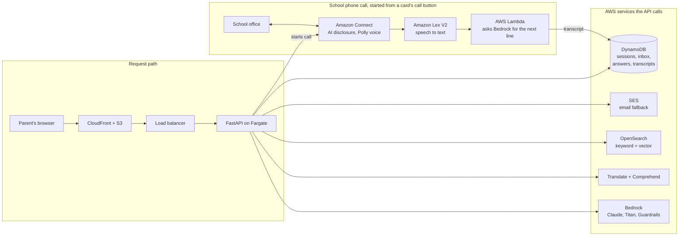

# GreatSchools Guided Search — How it works

Nov 4, 2026 · Living version: [Claude Docs](https://claude.ai/artifact/H1djgmm2mA1oqTGCDwPTTZ)

Guided Search is a school-search agent that investigates for parents. It turns a plain-language need into ranked schools and cites the field behind every fact. When a fact is missing, it phones the school with an AI assistant and updates the card for every parent who asked. It runs end to end on AWS (Bedrock, Connect, Lex, Lambda, Translate, OpenSearch, DynamoDB, Fargate, CloudFront) and is live at [dvpvz48phigre.cloudfront.net](https://dvpvz48phigre.cloudfront.net), with Jacksonville, FL as the demo city.

## 1. The problem we solve

Parents can't find the school facts they actually decide on, and the families with the least time, money and English lose the most. GreatSchools has 150,000+ school profiles and ~40M family visits a year, but today's search assumes a parent already knows the right filters and terms.

- **Blunt filters.** Search runs on location, grade and test scores. A need like "STEM, after-school care until 6, money is tight" has no filter.
- **Missing facts drop schools silently.** If a profile lacks after-care hours, a filter hides the school. The parent never learns it might have fit.
- **The gap falls on the parent.** To find out, a parent must phone each school's office during work hours. Twenty parents asking the same school the same question means twenty calls.
- **Jargon and language.** Choice, charter, lottery, ESA and voucher rules are hard in English and harder in Spanish or Haitian Creole.
- **Trust.** AI answers that sound sure but cite nothing are worse than no answer when the decision is a child's school.

The goal, in GreatSchools' words: move parents from a one-time *search* into an *explore* mode — "We investigate. You decide."

## 2. Tech stack

The app runs on 19 AWS services in `us-east-1`, defined in AWS CDK across four stacks (`GsAppStack`, `GsOpenSearchStack`, `GsGatewayStack`, `GsVoiceStack`). The default demo deploy from `main` ships `GsAppStack` (and optionally OpenSearch); Gateway and Voice stay off unless repo variables `DEPLOY_GATEWAY=1` / `DEPLOY_VOICE=1` are set. Every AWS feature sits behind a flag, so the same code also runs offline with a rules engine, a local index and a JSON file in place of each service.

The browser reaches one FastAPI service on Fargate. The phone loop runs outside it: Lambda writes each transcript to DynamoDB, and the API reads it back, checks the answers and updates the card.

### AWS services

| Layer | AWS service | What it does in our app | Code |
| --- | --- | --- | --- |
| AI reasoning | **Amazon Bedrock** — Claude Haiku 5.5 (fast), Claude Sonnet 5.5 (strong) via the Converse API | Routes each message, extracts criteria (require / prefer / avoid), drafts card summaries, and runs the phone conversation. Output is untrusted: code validates it and falls back to rules on any failure | `backend/agent/bedrock_client.py`, `backend/voice/lex_turn.py` |
| AI embeddings | **Amazon Bedrock** — Titan Text Embeddings V2 (256 dims) | Maps a parent's phrase to a need, and powers the vector half of search | `backend/mapping/embedder.py` |
| AI safety | **Amazon Bedrock Guardrails** (ApplyGuardrail, PII filter) | Second check on every parent community post: blocks names, emails, phone numbers and addresses | `backend/community/safety.py`, `infra/lib/app-stack.ts` |
| Agent tools | **Amazon Bedrock AgentCore Gateway** + AWS Lambda | Exposes school-data tools over MCP for other agents | `infra/lib/gateway-stack.ts` (`GsGatewayStack`, not in the default demo deploy) |
| Phone calls | **Amazon Connect** (outbound voice, contact flow, flow logs; instance + number imported) | Places the call to the school, plays the AI disclosure and consent question | `infra/lib/voice-stack.ts` (`GsVoiceStack`) |
| Speech | **Amazon Lex V2** (speech-to-text, turn-taking) | Turns what the school says into text; no barge-in, waits 5 s for an answer | `infra/lib/voice-stack.ts` |
| Voice | **Amazon Polly** (Neural voice "Joanna") | Speaks every AI line on the call | Connect flow + Lex locale in `GsVoiceStack` |
| Call logic | **AWS Lambda** (Python 3.12) | One invocation per thing the school says: asks Bedrock for the next line and saves the transcript | `backend/voice/lex_turn.py`, `infra/lib/voice-stack.ts` |
| Languages | **Amazon Translate** + **Amazon Comprehend** (language detection) | Reads a parent's message in any language and answers in it; the UI follows the parent's language | `backend/agent/translate.py` |
| Search | **Amazon OpenSearch Service** | Hybrid search: keyword (`multi_match`) plus k-NN vectors; only city, grade and school type are hard filters | `backend/search/query.py`, `data/index/indexer.py` |
| State | **Amazon DynamoDB** (on-demand, one `pk`/`sk` table) | Sessions, saved lists, the school question inbox, school-reported facts, and call transcripts | `backend/store.py` |
| Email | **Amazon SES** (sandbox) | Sends grouped parent questions to schools when no call is made; only to a verified address | `backend/gaps/ses_mailer.py` |
| API compute | **AWS Fargate** on **Amazon ECS** + **Application Load Balancer** | Runs the FastAPI backend as a container with health checks | `infra/lib/app-stack.ts`, `Dockerfile` |
| Web delivery | **Amazon CloudFront** + **Amazon S3** | Serves the React app over HTTPS and routes `/api/*` to the load balancer | `infra/lib/app-stack.ts` |
| Infrastructure | **AWS CDK** (TypeScript) + **AWS CloudFormation** | Four stacks: `GsAppStack`, `GsOpenSearchStack`, `GsGatewayStack`, `GsVoiceStack` (demo deploy = App; Gateway/Voice opt-in) | `infra/` |
| Security | **AWS IAM** + GitHub OIDC role `GsGitHubDeploy` | Least-privilege task roles (Connect calls scoped to one instance); deploys with no stored AWS keys | `.github/workflows/deploy-demo.yml` |
| Observability | **Amazon CloudWatch Logs** | Lambda logs and Connect flow logs show where a call went | `/aws/connect/...`, `/aws/lambda/GsVoiceTurn` |

### Application stack

| Part | Technology |
| --- | --- |
| Backend | Python 3.12, FastAPI, Pydantic, boto3, opensearch-py |
| Rules owned by code | YAML catalogs: `needs.yaml` (needs, phrases incl. Spanish, evidence conditions), `funding_rules.yaml`, `enrollment_rules.yaml`, `glossary.yaml`, `models.yaml` |
| Frontend | React 18, TypeScript, Vite, Leaflet maps, dark mode, UI strings translated at runtime |
| Data | 25 GreatSchools sample schools plus 275 synthetic schools, 49 programs and one website page each; pins snapped to real OpenStreetMap streets |
| Quality | 194 backend tests (pytest) and a 42-query evaluation set |
| CI/CD | GitHub Actions: merge to `main` → CDK deploy (about 10 minutes) |

## 3. What differs from today's search

Today's search filters and stops at what's on file; ours explains every fact, keeps schools with gaps on screen, and goes and gets the missing answer.

|  | Today: filter-based school search | Guided Search |
| --- | --- | --- |
| How a parent starts | Picks location, grade, rating filters | Writes one sentence, in any language: "Middle school in Jacksonville with STEM and after-school care. Money is tight." |
| Understanding the need | Parent must know the right filter and term | Agent extracts must-haves, nice-to-haves and things to avoid, asks up to 3 skippable questions, and shows a brief to approve |
| A fact that isn't on file | School is filtered out and the parent never knows | School stays on screen in "Missing a fact we can ask about"; unknown scores 0.5, never a fail |
| Filling the gap | Parent phones each office in work hours | **One tap: the AI phones the school**, asks every open question parents have, and updates the card for all of them |
| Trust | A rating with no reasoning | Each fact is Confirmed / Partial / Unknown and cites its field, review or call quote; a model can't change a card unless code verifies it |
| Repeated questions | 20 parents, 20 calls or emails | Grouped: the school gets one request, every parent gets the answer |
| Jargon and money | Parent decodes charter, lottery, ESA alone | Inline definitions, "Getting in" deadlines, and "You may qualify" scholarship links to official Florida pages (no promised amounts) |
| Comparing and saving | Separate tabs | "Compare these two", a saved list with a deadline checklist, and a map of the top 5 |
| Community | Reviews only | Parent Q&A per school with a PII guardrail; school staff answer once for everyone |

## 4. Our selling point

**When the data runs out, our agent picks up the phone.** One AI call to a school answers every parent who asked, and the answer stays in the database for every parent after them. We know of no other school-search product that closes its own data gaps.

### Why it draws attention

1. **A demo nobody forgets.** The parent taps "Have AI call Beauclerc STEM Middle"; a real phone rings; the transcript streams onto the card; the after-care cell flips from Unknown to Confirmed, 18:00, quoting the school's own words.
2. **The database fills itself where parents care most.** Calls go out only for facts parents actually asked about, so every call adds the most-wanted missing data. In the demo, 13 parents asked Beauclerc about after-school care — one call answers all 13.
3. **Facts that can be trusted.** The model drafts; code decides. An answer changes a card only if its quote was really said on the call and its value parses. If the school declines the transcript, nothing is kept. Every fact on screen cites its source.
4. **Low cost by design.**
    - Rules first: the extractor and evidence engine answer most turns with no model call (median turn 0.02 s in the evaluation).
    - The small, fast model (Claude Haiku 5.5) handles routing, extraction and phone turns; the larger model only drafts summaries.
    - Grouping turns N parent questions into one call or email, so cost per parent falls as demand grows.
    - Every AWS call has a fallback, so an outage degrades to rules, local search or email — never a blank screen.
5. **Built for the families with the least access.** Any language through Amazon Translate, plain-language definitions, no login, and nobody has to phone a school office during their own work hours.
6. **Responsible by default.** The AI says it is an AI and asks to transcribe before anything else (Florida requires all-party consent). Calls reach only one verified number in the demo, and community posts pass a Bedrock Guardrails PII check.

### Why AWS makes it possible

The whole loop — understand the parent, find schools, call the school, verify, update — runs on managed AWS services wired together in CDK: Bedrock thinks, Connect + Lex + Polly talk, Lambda bridges them, DynamoDB remembers, OpenSearch finds, Translate speaks the parent's language, and Fargate + CloudFront serve it. A new need or question for schools is a YAML edit, not a new system.
